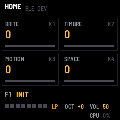
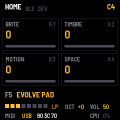
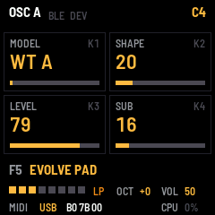
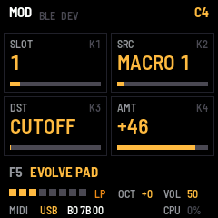
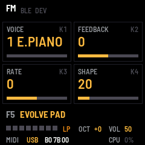
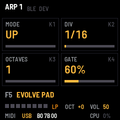
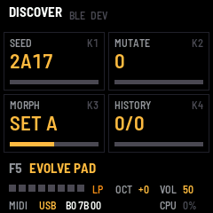
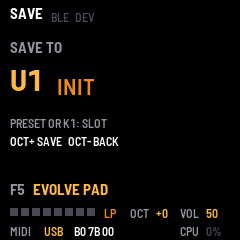

# POCKET POLY

POCKET POLY is a stereo hybrid polysynth for the M-VAVE FM-1, in development. Eight voices, each with two
oscillators that can be analog shapes, phase-distorted sines, wavetables or a six-operator FM voice, with hard
sync, ring modulation and cross modulation between them; a resonant filter with drive; three envelopes, two LFOs, an
eight-slot modulation matrix and four macros on the HOME knobs; then an ensemble, a tape delay, a plate reverb
and a limiter; an arpeggiator with twelve modes, a Euclidean rhythm, chance, ratchets and a Turing machine, which
follows MIDI clock and sends what it plays; and the discovery tools: DICE, MUTATE, MORPH and a history. Eight
factory patches and sixteen user slots. MIDI in over USB, Bluetooth and the TRS jack, MIDI out over USB and
Bluetooth, and the FM-1 as a sound card over USB.

---

## Contents

1. Install
2. The screen
3. Controls
4. Pages
5. The modulation matrix and the macros
6. Six-operator FM and DX7 voices
7. The FX layer
8. The arpeggiator
9. Finding patches: DICE, MUTATE, MORPH
10. Presets and saving
11. MIDI and audio
12. The screen reader
13. Troubleshooting

---

## 1. Install

**Try it first:** the emulator runs the same code in the browser, with sound, played with the mouse, a touch
screen or the computer keyboard.

**Install from the browser:** in Chrome or Edge, connect the FM-1 by USB, open the installer and press Install.
The browser asks once to allow MIDI: allow it. Don't unplug the cable while it writes.

**Install from a terminal:** `python3 base/tools/fm1_install.py app/build/pocketpoly.fwsc`.

**Back to the stock firmware:** the installer's last section writes M-VAVE's own firmware back. An FM-1 that
doesn't start can be recovered too. For details, see felucca-bsp's `tools/fm1_rescue.sh`.

---

## 2. The screen

| Part | What it shows |
| --- | --- |
| Header | The page. BLE: lit while a computer or tablet is connected over Bluetooth; DEV: lit while a Bluetooth MIDI device is. The note playing, on the right. A message for a moment after a change. |
| Cards | The page's four parameters, one per knob: the name, the value and a bar. |
| Footer | The preset (its slot and name; white while it has unsaved edits), one block per voice (lit while it sounds; dark blocks are voices the load governor set aside), the filter type, the octave, the volume, the last MIDI message in and where from, and the audio load. |

---

## 3. Controls

| Control | What it does |
| --- | --- |
| Keys | Play, with velocity and pressure, and send the note over USB and Bluetooth on the OUT channel (MIDI page; 1 to begin with). Pressing a held key harder sends aftertouch. |
| OCT− · OCT+ | The keys' octave, from −2 to +2. In the save dialog: back out, or save. On DISCOVER: SET A, SET B. |
| KNOB 1–4 | The page's four parameters. Turned fast, they step faster. |
| SELECT | The previous or next page. |
| ALGO | The filter type: LP, BP, HP. |
| PRESET | The previous or next preset (F1–F8 factory, U1–U16 user). |
| HOME | The HOME page: the four macros. |
| EDIT | OSC A, OSC B, MIX, VOICE, FM, in turn. |
| FX | Tap: FILTER, FX 1, FX 2, in turn. Hold: the FX layer — the four lowest white keys switch ENSEMBLE (F3), DELAY (G3), REVERB (A3) and DRIVE (B3) off and on, lit while heard; the screen lists them. The switches are live, not part of the patch. |
| ENV | AMP ENV, FLT ENV, MOD ENV, in turn. |
| LFO | LFO 1, then LFO 2. |
| SEL | MOD (the matrix, a slot at a time), MACROS (their names), then MIDI (the channels, clock out, local off). |
| ARP | ARP 1, ARP 2, ARP 3, TURING, in turn. |
| PLAY | The arpeggiator on or off (lit while on). |
| SEQ | Tap: DICE, a new random patch. With EDIT, FX, ENV, LFO, SEL or ARP held: dice that section only. Hold: the DISCOVER page. |
| SAVE | The save dialog. SAVE lights while there is something to save. |
| REC | Press: find and connect a Bluetooth MIDI device. Hold a second: Bluetooth off or on. |
| MASTER | The volume. |
| Every other button | Shows its name, and nothing else yet. |

---

## 4. Pages

| Page | K1 | K2 | K3 | K4 |
| --- | --- | --- | --- | --- |
| HOME | The four macros, by the names the patch gives them (see 5). | | | |
| OSC A | MODEL: SAW, PULSE, TRI, SINE, PD (phase distortion), WT A, WT B, WT C (wavetables), FM6 (six operators) | SHAPE: the pulse width, the distortion, the position in the wavetable, or BRIGHT for FM6 | LEVEL | SUB: a square an octave below A |
| OSC B | MODEL: as A, without FM6 | SHAPE | SEMI: −24 to +24 whole semitones | FINE: −50 to +50 cents |
| MIX | OSC B: its level | NOISE | XMOD: B modulates A's phase — two-operator FM with any carrier | RING: A × B |
| VOICE | SYNC: B restarts with A | DRIFT: slow random detune and wander per voice | VEL>AMP | LEVEL: the patch's output |
| FILTER | CUT: the cutoff, in Hz | RES | KEYTRK: the cutoff follows the key | DRIVE: saturation before the filter |
| FX 1 | ENS: OFF, CHOR I, CHOR II, ENSEMBLE (Juno-style, antiphase left and right) | ENS MIX | DLY SEND | REV SEND |
| FX 2 | DLY TIME: 20 ms to 830 ms; changing it bends the pitch like tape | DLY FDBK: dark, soft repeats | REV SIZE: the plate's decay | REV DAMP: how fast its highs die |
| AMP ENV | ATK | DEC | SUS | REL: 1 ms to 10 s |
| FLT ENV | ATK | DEC | SUS | REL |
| MOD ENV | ATK | DEC | LOOP: start again at the end | LEVEL: how much of it the matrix gets |
| LFO 1 | RATE: 0.05–30 Hz | SHAPE: TRI, SINE, SQR, SAW, S&H | PITCH: vibrato, up to ±2 semitones | CUT: up to ±4 octaves |
| LFO 2 | RATE | SHAPE | SPREAD: OFF in the middle. Turned up, the keys spread across the stereo field (low notes left); turned down, each voice takes its own place | GLIDE |
| MOD | SLOT: 1–8 | SRC: the slot's source | DST: its destination | AMT: −64 to +63 |
| MACROS | M1 NAME | M2 NAME | M3 NAME | M4 NAME |
| ARP 1 | MODE | DIV: 1/4 to 1/32, with triplets | OCTAVES: 1–4 | GATE: 5–200 % (over 100 % the notes tie) |
| ARP 2 | SWING | HITS: the Euclidean rhythm's hits | STEPS: its length, 1–16 | ROTATE |
| ARP 3 | CHANCE: each step's probability | RATCHET: how often a step repeats itself two or three times | LATCH | BPM: the internal tempo (EXT while MIDI clock runs) |
| TURING | LENGTH: the register, 2–16 | LOCK: how often a bit is kept rather than rolled | SEED | REPEAT: the same randomness every cycle |
| DISCOVER | SEED: turn it to browse patches | MUTATE: turn to nudge | MORPH: A to B | HISTORY: back and forward |
| FM | VOICE: one of the 32 bank voices, or LIVE (the dice's) | FEEDBACK: added to the voice's own | RATE: the envelopes faster or slower | BRIGHT: the modulators louder or quieter |
| MIDI | IN CH: OMNI or 1–16 | OUT CH: 1–16 | CLOCK OUT | LOCAL (see 11) |

The three wavetables: WT A sweeps the analog shapes, sine to narrow pulse; WT B moves two vocal formants
through A, E, I, O, U; WT C is glassy, a cluster of partials that climbs as the position rises. Each is
band-limited, so it stays clean high up the keyboard. Phase distortion bends a sine towards a saw as SHAPE
rises, the Casio way.

---

## 5. The modulation matrix and the macros

Eight slots, each a source, a destination and an amount. Sources: LFO 1, LFO 2, MOD ENV, velocity, key
position, pressure (aftertouch from the keys or MIDI), the mod wheel, a random value per note, and the four
macros. Destinations: pitch, cutoff, resonance, shape A, shape B, pitch B, XMOD, RING, level, pan, LFO 1 rate,
delay send, reverb send, ensemble mix, drive.

The four macros are the HOME knobs. Each is a value the patch saves and a source in the matrix; a macro does
whatever its slots say. Every patch starts with BRITE on cutoff, TIMBRE on shape A, MOTION on LFO 1's rate and
SPACE on the reverb and delay sends; change the routings on MOD and the names on MACROS.

---

## 6. Six-operator FM and DX7 voices

With MODEL FM6 on OSC A, the oscillator is a six-operator FM voice in the DX7's shape: 32 algorithms, operator
ratios or fixed frequencies, four-rate four-level envelopes, velocity and rate scaling, feedback. The voice comes
from a bank of 32 (factory: E.PIANO, FM BASS, BRASS, BELL, GLASS PAD, MARIMBA, ORGAN, FM LEAD, repeated) or from
LIVE, the voice the dice last made. Saving a patch that plays LIVE copies that voice into the bank as the slot's own
(user slot 1 → bank voice 9, slot 2 → 10, and so on), so the saved patch keeps its sound. The FM page shapes a voice
without editing operators: FEEDBACK and RATE offset the voice's own, BRIGHT raises or lowers every modulator. Oscillator B, the sub and noise still mix in; the filter,
envelopes, matrix and effects apply as to any model. Dicing the oscillators of an FM6 patch (EDIT held, SEQ) also
dices a new LIVE voice.

**DX7 voices over MIDI:** a single-voice dump (the format Dexed and most editors send) goes into the slot the
patch uses, and the bank is saved. A 32-voice bank is sent voice by voice with the Mac tool:
`python3 tools/fm1_dx7.py BANK.syx` (the platform passes the app 640-byte frames at most, so the 4104-byte bulk
dump itself cannot arrive). LFO, pitch envelope and key-level scaling of the DX7 voice are not used; the synth's
own LFOs and matrix stand in.

---

## 7. The FX layer

Hold **FX**: the keys stop playing notes and the four lowest white keys become switches — **F3** ensemble,
**G3** delay, **A3** reverb, **B3** drive — lit while that effect is heard on the current patch, dark when the
patch doesn't use it or you switched it off. Press a key to switch; the screen shows ON, OFF or NOT IN PATCH for
each while FX is held. The switches are a live state for comparing and performing: they are not saved with the
patch, and a switched-off delay or reverb keeps its tail frozen, so switching back on is seamless. Let go of FX
and the keys play again. A short tap of FX, with no key pressed, still cycles the FILTER, FX 1 and FX 2 pages.

---

## 8. The arpeggiator

Press PLAY. Held notes (from the keys or MIDI) become a pattern at the tempo on ARP 3 (or the MIDI clock, when
one arrives), and every note the arp plays goes out over USB and Bluetooth MIDI on the OUT channel.

**Modes:** UP, DOWN, UP DN, ORDER (as played), RANDOM, WALK (a random neighbour), CONV (outside in), DIVERGE
(inside out), PINKY (the top note between each of the others), THUMB (the bottom note between each), CHORD (all at
once), TURING (a shift register picks the notes: LENGTH is its size, LOCK how often it keeps a bit — at 100 % the
pattern loops, lower and it slowly changes).

**Rhythm:** the Euclidean pattern on ARP 2 spreads HITS over STEPS as evenly as possible (3 over 8 is the
tresillo); ROTATE turns it. CHANCE skips steps at random; RATCHET repeats a step two or three times. SWING delays
every second step. GATE sets the length of each note; over 100 % the notes overlap.

**Randomness you can keep:** the arp's random decisions come from its SEED (TURING page). With REPEAT on, every
cycle of STEPS re-seeds, so a random pattern repeats exactly; turn SEED to hear another one, and save the patch to
keep it. With REPEAT off the randomness runs free.

**LATCH** keeps the notes after you let go; a new chord replaces them.

---

## 9. Finding patches: DICE, MUTATE, MORPH

**DICE** (tap SEQ) makes a whole new patch from a seed, within ranges that keep it a sound: it is named after its
seed (DICE 3F2A), and the same seed always gives the same patch. Hold EDIT, FX, ENV, LFO, SEL or ARP while you tap
SEQ to dice only that section and keep the rest.

**DISCOVER** (hold SEQ) puts the tools on the knobs. **SEED** turns through the neighbouring patches, one per
detent — browsing the random space. **MUTATE** nudges about a third of the continuous parameters a little each
turn. **MORPH** blends two patches: press OCT− to store the current one as A and OCT+ for B, then turn. **HISTORY**
steps back and forward through everything DICE, MUTATE and MORPH did, sixteen steps deep.

Whatever you find, SAVE keeps it in a user slot.

---

## 10. Presets and saving

Turn PRESET to browse: F1–F8 are the factory patches, U1–U16 yours. Loading a patch replaces any unsaved edits.

Press SAVE: the dialog shows the user slot it will write (the current one, if you are on a user patch). PRESET or
KNOB 1 picks another; OCT+ saves, OCT− (or any other button) backs out. Saving also keeps the octave and whether
Bluetooth is on. A MIDI program change 0–23 loads a slot.

---

## 11. MIDI and audio

MIDI comes in over USB, Bluetooth and the TRS jack: notes play the voices (or the arp), pitch bend moves them
±2 semitones, poly and channel aftertouch reach the matrix, program change 0–23 loads a slot. MIDI clock, start,
continue and stop drive the arp while they come; two seconds after the clock stops, the internal tempo takes over
again. The keys send notes with their velocity, and poly aftertouch, out over USB and Bluetooth.

The controllers it answers:

| CC | Does |
| --- | --- |
| 1 | Mod wheel (a matrix source) |
| 7 | Volume |
| 16 · 17 · 18 · 19 | Macro 1–4 |
| 64 | Sustain pedal: released notes hold until it lifts. With the arp on, it latches the chord. |
| 71 · 74 | Resonance, cutoff |
| 73 · 72 | Amp attack, amp release |
| 91 · 93 · 94 | Reverb send, ensemble mix, delay send |
| 120 · 123 | All sound off, all notes off |
| 121 | Reset controllers: wheel, bend, pressure and pedal back to rest (the volume stays, as the MIDI spec asks) |

A CC that changes a parameter edits the patch like a knob: SAVE lights.

The MIDI page (SEL, after MOD and MACROS) holds the settings, kept with SAVE:

| Knob | Setting |
| --- | --- |
| KNOB 1 | IN CH: OMNI (every channel) or 1–16, the channel POCKET POLY listens to |
| KNOB 2 | OUT CH: the channel the keys and the arp send on, 1–16 |
| KNOB 3 | CLOCK OUT: while the arp runs on its own tempo, MIDI clock, start and stop go out with its notes, 24 a beat |
| KNOB 4 | LOCAL: OFF makes the keys send MIDI without playing the voices (a controller for a DAW that sends the notes back) |

Over Bluetooth, POCKET POLY advertises as "FM-1". On a Mac, open Audio MIDI Setup, choose Window > Show MIDI Studio,
click the Bluetooth button, then Connect next to FM-1. On an iPad or iPhone, connect from a music app's Bluetooth
MIDI settings.

To switch Bluetooth off, hold REC for a second: the screen says BLUETOOTH OFF, and the FM-1 stops advertising
and drops any connection. Hold REC again to switch it back on. Save to keep the choice.

To connect POCKET POLY to a Bluetooth MIDI device, such as a keyboard or a controller, put the device in its pairing
or advertising mode, then press REC: the screen says BLE SCANNING. Turn ALGO to pick the device by its name, and
press REC again to connect. DEV in the header lights while it's connected. Press REC once more to disconnect.

The keys sense how hard they're played, with no change to the FM-1. The 20 lowest keys (F3 to C5) give velocity
and pressure; the top seven give velocity only.

Over the USB cable the FM-1 is also a sound card: a computer can record what it plays (an input named
"POCKET POLY FM-1").

When the audio load passes 90 %, one voice is set aside until the next power-on, and the screen says so: the music
keeps playing.

---

## 12. The screen reader

POCKET POLY tells a screen reader what's on its screen, through the
[FM-1 Screen Reader](https://charlesvestal.github.io/fm1-reader/): the page and the preset when the reader starts
listening, then each change as it happens. The emulator does the same, with your own screen reader or with its
built-in voice.

---

## 13. Troubleshooting

**No sound:** turn MASTER up. Check the patch's LEVEL (VOICE page) and the oscillator levels (OSC A, MIX).

**The installer doesn't find the FM-1:** use Chrome or Edge, allow MIDI when asked, and close other programs
that use the FM-1's MIDI port.

**The FM-1 doesn't start after an install:** after two failed starts it waits in the chip's update mode. Put
the stock firmware back, then install again. For details, see felucca-bsp's `tools/fm1_rescue.sh`.
